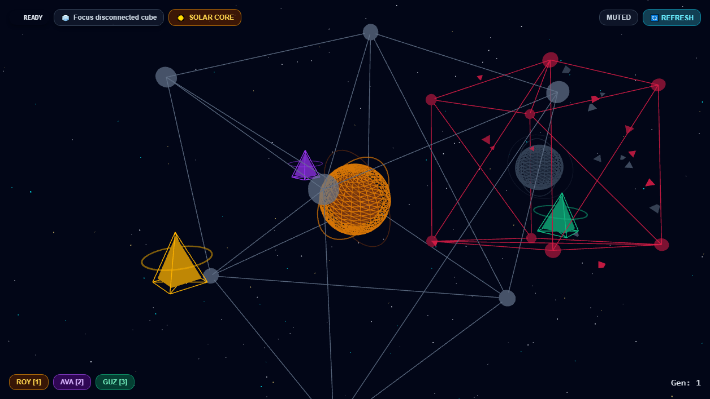
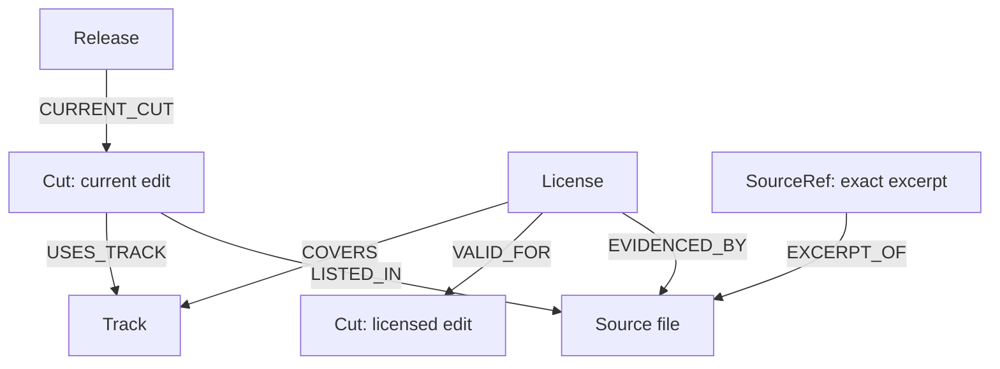
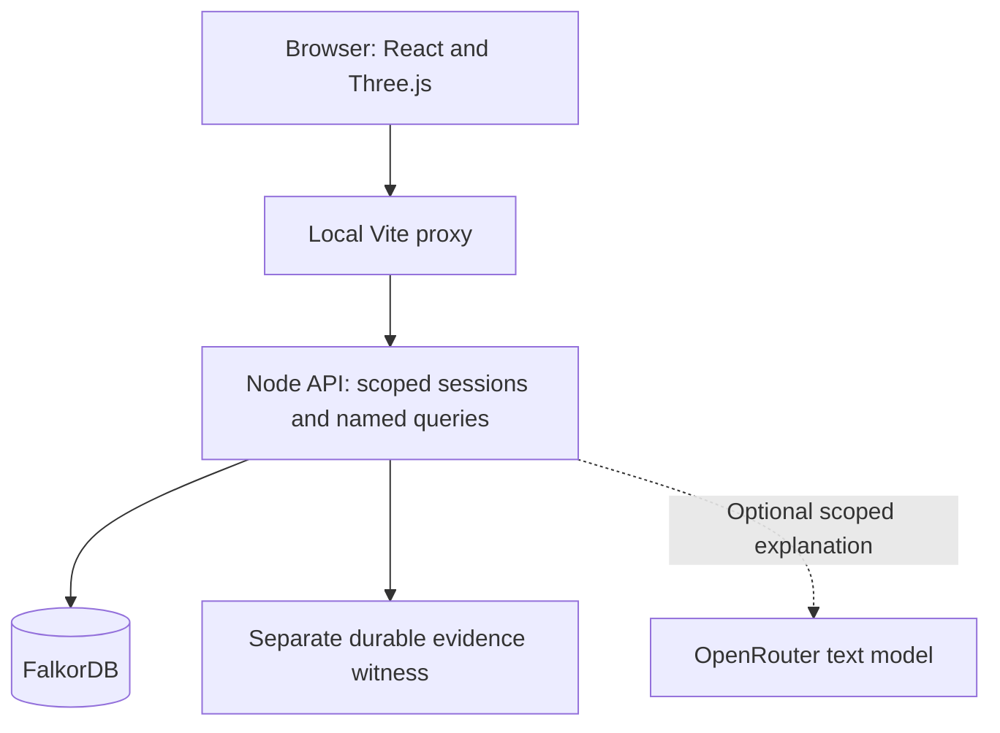

# Cubes of Knowledge

**A company brain that shows its evidence—and stops answering when its graph is unavailable.**

Built with FalkorDB, React and Three.js for the **Graph Hacks Company Brain** track. WAD Studios, its people, music licenses and idea files are fictional, synthetic demo data.

> **Can the current cut of Warnings After Dark ship?**  
> **GAP:** *Basement Hum* is cleared only for Cut v3. The current Cut v4 needs a new license. *Night Drive* is licensed for Cut v4. Follow each result back to its source excerpt.



## The demo

| Experience | What it demonstrates |
| --- | --- |
| **Company Cube** | A 3D workspace with a solar core, Roy/Ava/Guz agent representations and comet-like idea files. Evidence paths come from returned graph relationships. Decorative geometry is not proof. |
| **Inspect a source** | Follow release → current cut → track → version-scoped license → source reference. Open the original excerpt, source path, Unicode code-point offsets and hash display. |
| **Lose the graph** | Real graph failure clears current proof and blocks protected actions. Restart and re-query to recover fresh results from the graph. |
| **Disconnected comparison cube** | A separate, permanently unconfigured cube: “No database connected.” It cannot query, import, or borrow the main cube's results. |
| **IdeaVerse** | A checked-in pool of 100 synthetic idea files. Local owner rehearsal can import an idea; “Added” requires a server receipt and a fresh graph read-back. Uncertain outcomes remain unconfirmed. |
| **Optional explanation** | A low-cost OpenRouter text model explains scoped graph evidence. Citation ids are checked; the model cannot grant access, change clearance or approve a release. Disabled by default. |
| **Voices** | Recorded ElevenLabs agent clips plus separate optional browser read-aloud. Audio starts muted. Outage and recovery clips follow guarded graph states. |

## Graph map: where the answer comes from



The licensed edit must match the current edit. In the default story, *Basement Hum* has evidence for Cut v3 while the release's current cut is v4: **STALE**, contributing a **GAP**. *Night Drive* has valid v4 evidence: **VERIFIED**. A track title or an approval alone cannot establish clearance.

**How the agent uses FalkorDB:** the API chooses fixed, tenant-scoped query paths; the model never writes Cypher. Analysis reads one evidence snapshot from FalkorDB, checks it against the separate signed witness, then follows current cut → used tracks → covering licenses → licensed cuts and cited excerpts within that same snapshot. It verifies source hashes, excerpts and version scope before deriving the clearance. The [named query catalog](packages/graph/src/queries.ts) and [snapshot traversal](packages/graph/src/snapshot-rows.ts) show the implementation.

For example, the current-cut query begins with this parameterized traversal:

```cypher
MATCH (r:Release {id: $releaseId, tenantId: $tenantId})
      -[:CURRENT_CUT]->(c:Cut {tenantId: $tenantId})
RETURN r.id AS releaseId, c.id AS cutId, c.version AS cutVersion
```

This shortened example illustrates the catalog's traversal; the actual query returns provenance fields too. The optional explanation receives the resulting scoped facts and citation ids, and the API rechecks current graph evidence before accepting the model response. **FalkorDB and verified source scope determine the result; generated prose explains it.** When the graph cannot be read, the system withholds the answer.

## Architecture



Graph and model credentials stay server-side. The default local proxy uses a reader session; owner rehearsal is explicitly enabled and loopback-only. Displayed persona or access tags do not authorize requests.

## Run locally

Requires **Node 22.12+** (24 recommended), npm, and a reachable FalkorDB instance.

```sh
git clone https://github.com/Ranger-Jay/GraphHacks-Cubes-of-Knowledge.git
cd GraphHacks-Cubes-of-Knowledge
git switch gem/visual-preservation-v054
npm ci
cp .env.example .env
```

PowerShell: use `Copy-Item .env.example .env`.

Continue with the [complete setup reference](docs/local-setup.md): start your database, configure private signing/session values, initialize a **new disposable graph and witness**, seed the IdeaVerse pool, and start the API/web terminals. Preserve the witness and graph across restarts; do not initialize an existing shared graph.

Open **http://127.0.0.1:5173/#/releases/rel-wad**. Use this origin for optional Explain. For local owner import, follow the [owner-rehearsal setup](docs/owner-rehearsal-v038.md). For a provider key, follow the [Talker configuration and budget policy](docs/talker-v052.md).

**Runtime scope:** independent execution used pinned FalkorDBLite 0.10.0 and real Chromium. Docker configuration is included but has not been runtime-verified by that evidence. The entrant also reported successful Cloud graph/API reads from a local machine. A public hosted application is not established. A static frontend upload alone does not supply the API/session proxy.

## Verification and limits

The independently reviewed code is **`fd71b7bcc94c417b3d3677fcb79d647cc9306ea8`**. Later packaging changes are documentation only and require a diff review.

- **302/302** verification tests and **108/108** real-graph cases passed in Claude's review.
- **49/49** owner-rehearsal journey checks passed, including import/read-back, access loss, reader denial and real database stop/restart.
- Cora independently reproduced the filming journey in real headless Chrome, including keyboard navigation, source highlighting and comparison-cube isolation.
- One real capped `mistralai/mistral-nemo` completion and one browser Explain answer were reported from the entrant's host. Claude checked the metadata and answer for consistency; he did not independently execute the provider call.
- **Not implemented:** persistent agent memory, agent handoff across sessions, approval writes or production login/session issuance. Server session kinds are owner/reader/agent; persona profile tags do not implement five permission levels.
- Remaining limits include final human visual parity review, other browsers, and native audio behavior outside the entrant's listening checks. Known minor console, clipping and labeling findings are recorded; a headless pass does not establish audible playback.

See the [submission and evidence reference](docs/submission.md) for exact review links and the short recording journey. `/api/health` deliberately returns `BOOTSTRAP, ready=false` as process-liveness metadata; actual graph readiness comes from `/api/graph/status`.

## Documentation

[Documentation index](docs/README.md) · [Local setup](docs/local-setup.md) · [Graph schema](graph/schema/README.md) · [Seed data](graph/seed/README.md) · [Named queries](graph/queries/README.md) · [Engineering rules](AGENTS.md)

## Credits and AI assistance

**Jay (Ranger-Jay)** directed the product and art, paired on implementation, selected and checked the voices, tested the experience, and owns the final release and submission.

AI assistance was used throughout development:

| Tool or collaborator | Contribution |
| --- | --- |
| **OpenAI ChatGPT/Codex — Buddy** | Coordination, application integration, contracts, API/UI engineering, documentation and verification support. |
| **Anthropic Claude** | Early graph/schema/query/fixture work and independent later engineering, real-browser and real-graph verification. |
| **Google Gemini — Gem** | Visual development, scene renderer/adapter, comparison cube and documentation. Final parity with the approved artwork remains a human visual decision. |
| **Meta Muse Spark — Boons** | Engineering/testing support, review coordination and demo-video assembly. |
| **Grok-based collaborators — Mara and Cora** | Engineering, documentation and independent verification across their assigned lanes. |
| **Leonardo** | AI-assisted visual asset work, disclosed by the entrant. Concept artwork is distinguished from recorded application footage. |
| **ElevenLabs** | Synthetic agent voice clips. Jay selected settings, generated and repeatedly listened to the 29-file set. Browser read-aloud is a separate device-voice feature. |
| **OpenRouter / Mistral Nemo** | Optional runtime text explanation over scoped graph evidence. |

AI review does not replace human responsibility for the submission. No distribution license has been selected for this repository; dependencies and supplied assets retain their applicable terms.

[Graph Hacks](https://www.wemakedevs.org/hackathons/falkordb) · [Rules](https://www.wemakedevs.org/hackathons/falkordb/rules) · [FalkorDB documentation](https://docs.falkordb.com/)
