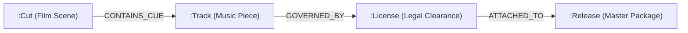

# Graph Schema & FalkorDB Relational Specification

**Document ID**: `IDEA-042`  
**File**: `ideaverse/GRAPH_SKETCH.md`  
**Category**: `CORE ARCHITECTURE`  
**Authors**: Ava (System Architect) & Gem (Art Director)  
**Revision**: `rel-wad@r2`  
**Status**: Verified Studio Clearance Contract  

---

## 1. Overview & Dual-Layer Hypergraph
This specification defines the FalkorDB schema for studio music clearance, cue sheets, and production track indexing.

## 2. Node Schema
- **`:Cut`**: `cutId`, `sceneCode`, `timecodeIn`, `timecodeOut`, `durationSec`.
- **`:Track`**: `trackId`, `title`, `isrcCode`, `artist`, `bpm`, `masterTapeHash`.
- **`:License`**: `licenseId`, `territory`, `expiryDate`, `royaltyRate`, `clearanceHash`.
- **`:Release`**: `releaseId`, `versionTag`, `merkleRoot`, `verifiedAt`.

## 3. Zero-Error Clearance Proof Contract
Every `:Cut` must have a verified path to an active `:License`. If any `:Track` lacks clearance, the studio gatekeeper (Roy) triggers an automatic fail-closed lock on the master release package.
